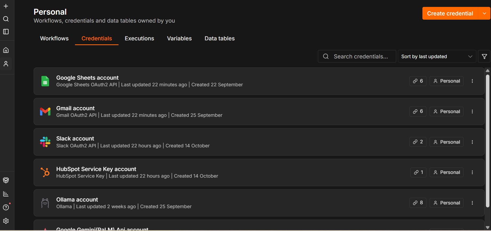
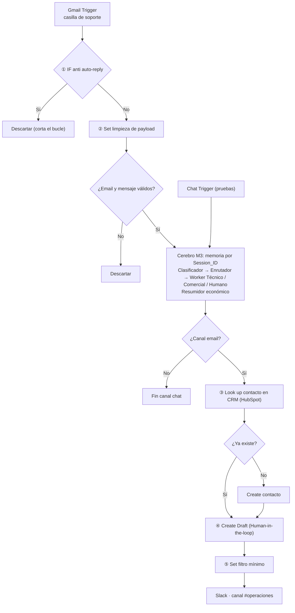

# CellZolution · Checkpoint 4 — Sincronización del Cerebro Agéntico con Ecosistemas de Negocio

**Alumno:** Ezequiel Campo · **Curso:** Automatizaciones con IA (Coder House) · **Entrega:** `checkpoint4_ezequiel_campo.json`

Este checkpoint **no arranca de cero**: parte del workflow del Módulo 3 (Manager–Worker con memoria y contexto en Google Sheets) y le suma tres integraciones reales del negocio —**CRM (HubSpot), casilla de soporte (Gmail) y canal del equipo (Slack)**— con autenticación segura (**OAuth2** en Gmail y Slack; token de clave de servicio en HubSpot), permisos de mínimo privilegio y controles preventivos no-code en el lienzo.

## Credenciales activas

| Rol en el negocio | Conector n8n | Credencial | Autenticación |
|---|---|---|---|
| CRM de la tienda | HubSpot | `HubSpot account` | Token de clave de servicio (HubSpot reemplazó las apps OAuth2 clásicas) |
| Casilla de soporte | Gmail (+ Gmail Trigger) | `Gmail account` | OAuth2 |
| Canal del equipo de operaciones | Slack | `Slack account` | OAuth2 |

## Arquitectura del flujo

## Los 4 nodos clave de la rúbrica

| # | Nodo | Qué evita | Cómo está configurado |
|---|---|---|---|
| ① | **IF anti auto-reply** (inmediatamente después del trigger) | Bucle infinito de auto-respuestas | Condiciones con OR sobre el asunto (`Auto-reply`, `Out of office`, `Undeliverable`, `Respuesta automática`, `Mail delivery failed`…) y sobre el remitente (`no-reply@`, `noreply@`, `mailer-daemon`, `postmaster@`). También descarta los correos de log propios (`[LOG]`, `CellZolution \| Log`). Rama *true* → se frena. |
| ② | **Set limpieza de payload** + validación | Error 400 (payload mal formado) y payloads pesados | Deja solo `cliente_email`, `cliente_nombre`, `asunto_original`, `mensaje_limpio` (texto sin HTML, máx. 1.500 caracteres), `thread_id`. Un IF posterior descarta si el email o el mensaje quedan vacíos. |
| ③ | **Look up contacto en CRM** antes del Create | Error 409 (contacto duplicado) | HubSpot *Search* por `email`. Si existe, se reutiliza; solo si no existe se ejecuta *Create*. |
| ④ | **Create Draft** (Human-in-the-loop) | Envío autónomo de la IA | La respuesta del agente se guarda **solo como borrador** en Gmail. En todo el workflow no hay ningún nodo *Send*: incluso el log interno es un borrador. Una persona revisa y envía. |

Además, el nodo **⑤ Set filtro mínimo** limpia el payload antes de Slack: solo viajan cliente, asunto, intención, estado del CRM y los primeros 300 caracteres de la respuesta (sin binarios ni objetos completos).

## Mínimo privilegio (scopes)

| Conector | Lectura (pasado) | Escritura (futuro) | Scopes / permisos acotados |
|---|---|---|---|
| HubSpot | Buscar contacto por email | Crear contacto (solo si no existe) | `crm.objects.contacts.read`, `crm.objects.contacts.write`. Sin acceso a deals, empresas ni tickets. |
| Gmail | Leer correos no leídos de INBOX | Solo crear borradores | Se usa únicamente `Get/Trigger` y `Create Draft`; no se configura ninguna operación de envío ni de borrado. |
| Slack | — | Publicar mensaje en un canal | `chat:write`. Sin lectura de historial ni de usuarios. |

Los agentes de IA no escriben en ningún sistema: las escrituras las hacen nodos fijos (principio ya aplicado en el Módulo 3).

## Cómo importar y probar

1. En n8n: **Workflows → Import from file** → `checkpoint4_ezequiel_campo.json`.
2. Asignar las credenciales de HubSpot, Gmail, Slack y Google Sheets (el semáforo de cada una debe estar en verde).
3. Verificar que el modelo Ollama (`qwen2.5:3b`) esté disponible y que los sub-workflows Worker Técnico y Worker Comercial estén **publicados**.
4. Casos de prueba de regresión (*Test step* / *Execute Workflow* en cada nodo):
   - Correo de un cliente nuevo → se crea el contacto, queda un borrador y llega el aviso a Slack.
   - Mismo cliente otra vez → *Look up* lo encuentra, no hay duplicado (sin error 409).
   - Correo con asunto `Out of office` o desde `no-reply@` → el IF ① lo descarta.
   - Correo sin cuerpo → se descarta en la validación del payload.
   - Chat Trigger → sigue funcionando como en el Módulo 3 (canal de pruebas).

## Evolución del proyecto

`M2 Workers` → `M3 Manager + memoria` → **`M4 Integraciones (este repo)`** → Proyecto Final.
